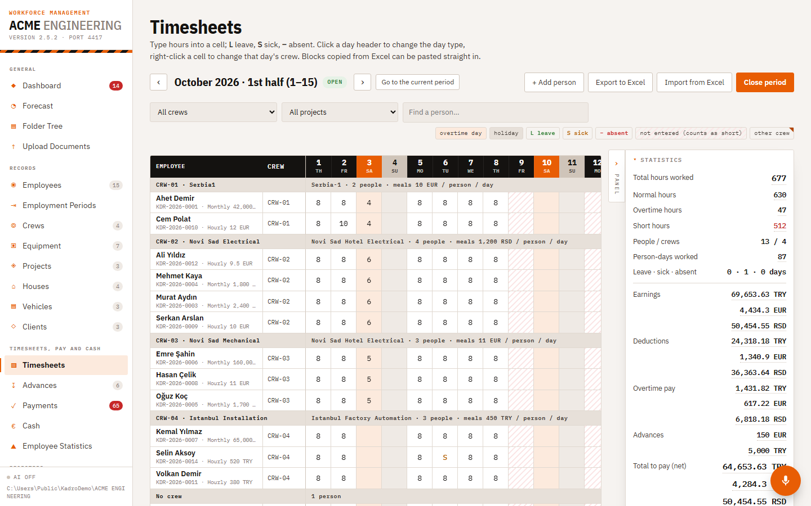
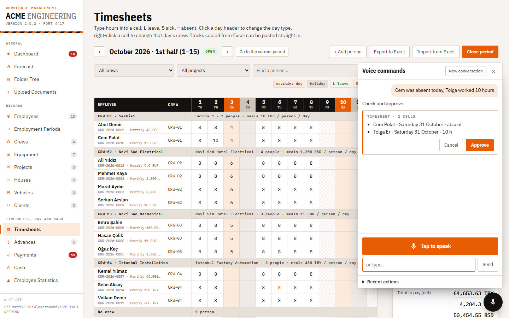
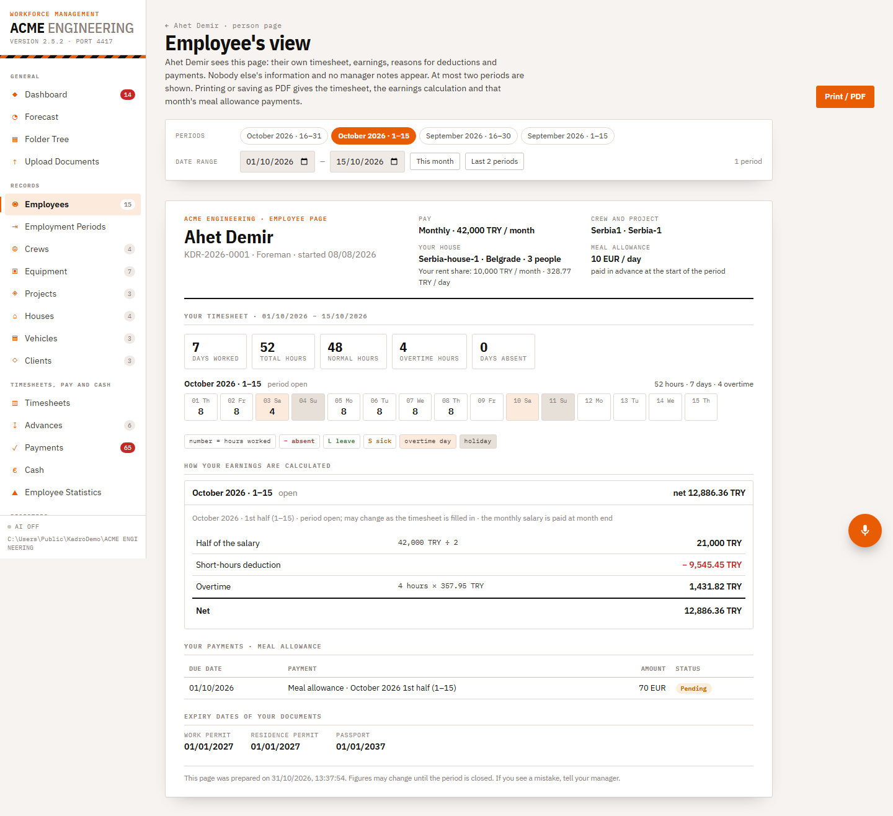
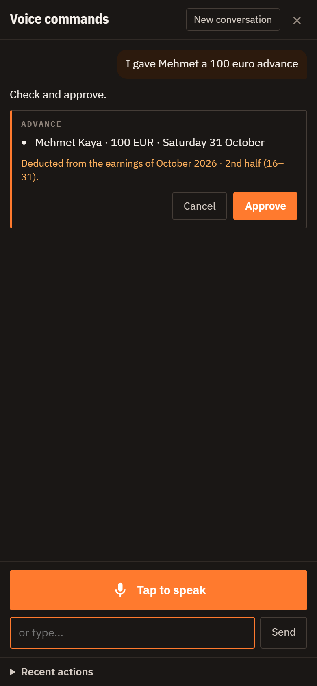
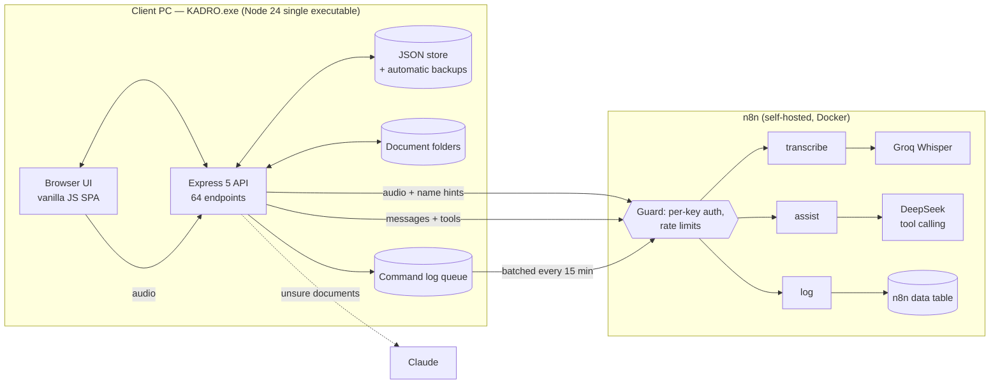

# Kadro — Workforce Management

Kadro runs the back office of a field contractor: an engineering company that sends crews of electricians and
technicians to project sites abroad. It replaces a pile of Excel sheets and folders with one local app:
employees and crews, a calendar timesheet, payroll with deductions in three currencies, advances, a cash book,
payments, company housing, vehicles, equipment, and the document folders for all of them. The office manager
can also **speak** to it: *"Cem was absent today, Tolga worked 10 hours"* turns into two timesheet cells waiting
for one click of approval.

It is not a CRM: there is no sales pipeline. It is workforce management — who works where, how many hours,
what they are owed, and what has been paid.

It is in production at a real client. The client's name, people and infrastructure are anonymized here, and this
showcase version is fully in English (UI, code, data fields, voice commands and docs).



| Voice command with confirmation card | Employee's own page (screen and PDF) | Phone |
|---|---|---|
|  |  |  |

## What it does

- **Records like spreadsheets.** Employees, crews, projects, clients, houses, vehicles and equipment are edited in
  Excel-like tables (paste blocks from Excel, import/export `.xlsx`). Every new person, project or vehicle gets its
  own folder tree on disk automatically.
- **Calendar timesheet.** Two periods a month (1–15, 16–end). Hours, overtime, leave, sick days, absences, a person
  working for another crew for one day. Each period is calculated with the rules it was opened with, so a rule
  change never rewrites a closed or running period.
- **Payroll.** Monthly and hourly pay, overtime, deductions for absent days (daily salary, share of rent, meal
  allowance), advances, and fixed exchange rates between EUR, RSD and TRY. Every number can be expanded into the
  formula that produced it.
- **Cash and payments.** A payments list (salaries, meal allowances, rents) with "paid" checkboxes that write to the
  cash book; cash rows for advances, salaries and rents are derived from their sources and kept in sync.
- **Employment periods.** Contracts with start/end dates drive each person's status and which days count.
- **Employee's view.** A page and a printable PDF showing an employee only their own timesheet, earnings breakdown
  and meal-allowance payments.
- **Document intake.** Drop a scanned passport or a PDF invoice; rules match names, plates and project codes, and
  when they are unsure Claude reads the document and proposes the folder.
- **Voice commands.** Timesheet entries, advances, cash expenses, marking payments, moving people between crews,
  and questions ("How much will Murat get this month?"). Nothing is written until the user approves a card, and
  every approved action can be undone.
- **Forecast, statistics, expiring documents** (permits, passports, insurance, leases) on the dashboard.

## Architecture



The app is deliberately boring: no framework, no database server, no build step during development. One
`node server.js` and a browser. For the client it is a single `.exe` with no installation.

## The pipelines

### 1. Voice command
`browser MediaRecorder → /api/assistant/voice → n8n transcribe (Groq Whisper, active employee names as a
spelling hint) → text → n8n assist (DeepSeek, OpenAI-style tool calling) → tools run inside the app`

- The model never touches data. **Read tools** (timesheet, person summary, payments, cash, advances) run and return
  a compact summary. **Write tools** only validate and return a **confirmation card**; the record is written when
  the user presses *Approve*, after validating again against the current data.
- **Undo** restores the previous value and refuses if the record was edited by hand in the meantime.
- The system prompt is built by the app (today's date, rules, active employees, crews, houses, projects), so
  behaviour changes ship with the app, not with the server.
- **Call budget:** if a turn contains only valid write calls, the app writes the reply itself instead of calling the
  model again. Most commands cost one model call, questions two.
- **Whisper hallucinations** on silence ("Thanks for watching!", echoes of the name hint) are filtered without
  dropping real commands that consist mostly of names.
- **Privacy:** IBANs, phone numbers, passport numbers and manager notes are never sent to the model (tested).

### 2. Command log
Every command and every card event (approved, cancelled, undone, expired) is appended to a local monthly JSONL
archive and a send queue, then shipped to an n8n data table in batches. Each record has per-turn latency, token
usage (including cache hits), tool calls with arguments and results, and the outcome. If the server is down,
nothing is lost: the queue is sent later. This is the data used to tune prompts and costs.

### 3. Document classification
Rules first (keywords, names, plates, project codes from the tables, confidence score), Claude second for scans and
PDFs the rules cannot place. The result is a folder proposal the user confirms.

### 4. Packaging and delivery
`esbuild bundle → Node Single Executable Application blob → postject → rcedit (icon, version)`.
The client gets one `KADRO.exe`. Data lives in the user's Documents folder, not next to the exe, so updating is
"replace the file". On the first start of a new version the app backs up the data before migrating it; this path
is tested by upgrading a real previous release.

### 5. n8n deployment
`n8n/build_workflows.py` builds the three workflows from a live export of a sibling project's workflows, so the
authentication guard, error contract and credential bindings are inherited instead of duplicated.
`n8n/deploy.sh` backs up, imports, publishes, restarts and verifies (rejection path, a real model call, a log
write), working around n8n's import/publish/restart quirks. `n8n/download-log.sh` pulls the command log for analysis.

## Running it

Node.js 24 is required.

```bash
npm install
npm start                    # http://localhost:4360
npm test                     # API test suites, offline (fake n8n)
bash test/run.sh ui          # + browser tests (Python Playwright)
npm run build                # dist/KADRO.exe
```

`KADRO_FOLDER=<folder>` runs against a separate data folder. Voice commands need an n8n with the three workflows
(`KADRO_ASSISTANT_URL`, `KADRO_ASSISTANT_KEY`); the tests use `test/mock-n8n.mjs`, a rule-based stand-in that
speaks the same contract. `node seed-demo.mjs` fills a running instance with demo records.

| Suite | Checks |
|---|---|
| Voice command end-to-end (cards, undo conflicts, multi-turn, audio, error codes, privacy) | 48 |
| Command log (archive, batching, offline queue, privacy) | 25 |
| Status lock for people with employment periods | 3 |
| Browser: voice panel (desktop, phone, dark mode, print) and employee view / PDF | 18 + 15 |

## Layout

```
server.js            API, startup migrations
public/              UI (index.html, app.js, style.css)
src/                 domain modules: timesheet, payments, cash, forecast, contracts (employment periods),
                     employee-view, assistant (voice), assistant-log (command log), classifier (documents),
                     folders / structure (folder tree), relations, tables, notes, rates, db, excel
build.mjs            single-exe build
seed-demo.mjs        demo data through the API
n8n/                 workflow builder, deploy and log download scripts
test/                test suites, fake n8n, sample company data (fictional)
docs/                screenshots and the script that takes them
USER_GUIDE.md        user guide
```

## Notes

- Sample data is fictional; people and companies keep Turkish and Serbian names, as at the real client.
- Server addresses, keys and the client's identity are not in this repository.
- © All rights reserved. Shared to show the work; not licensed for reuse.
